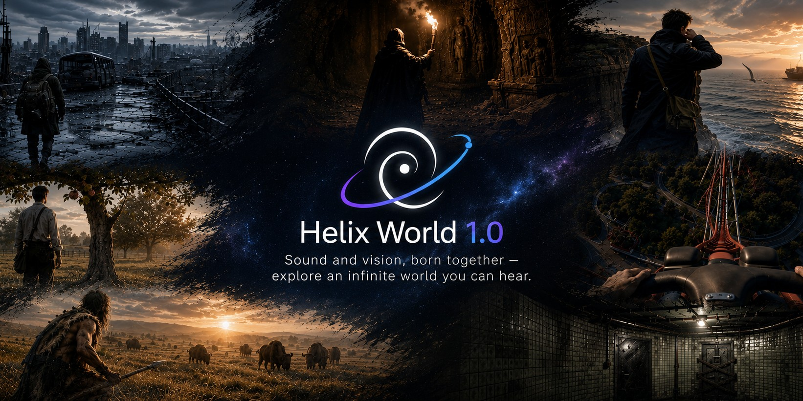
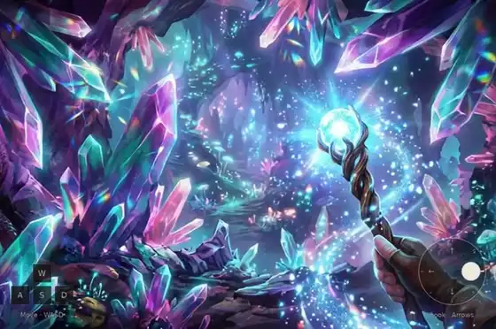
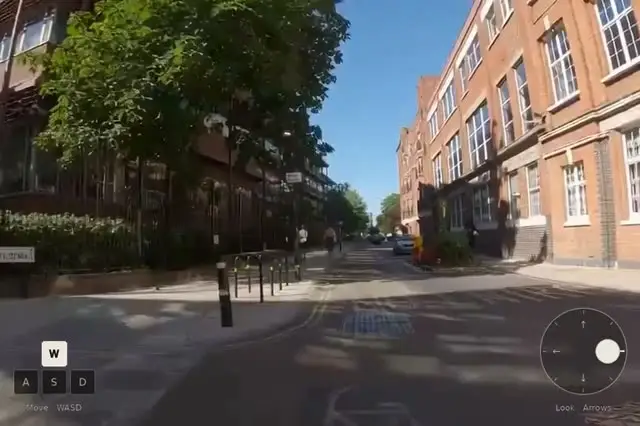
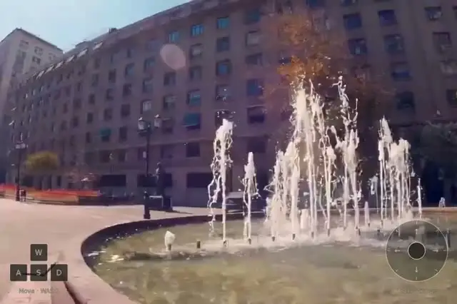
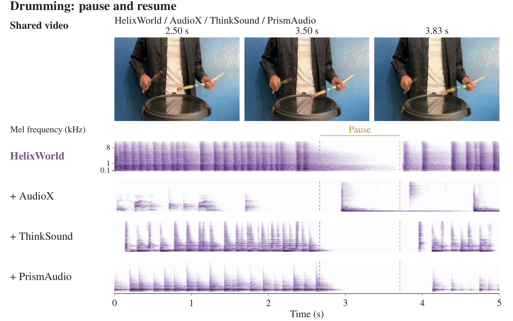
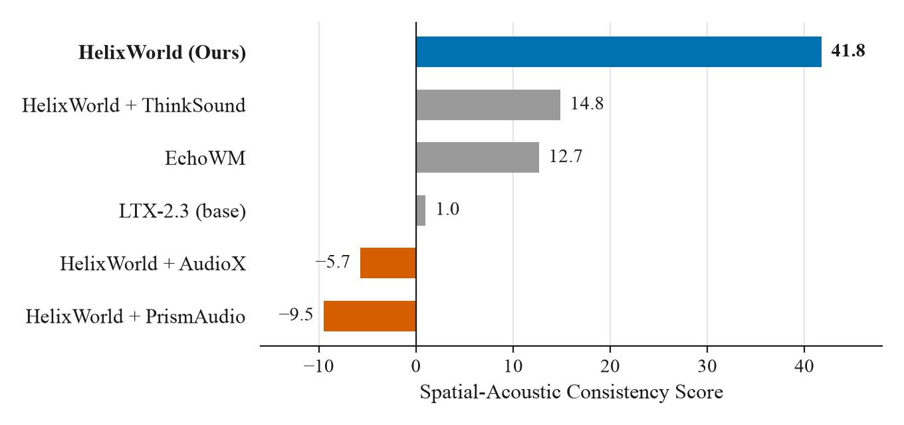
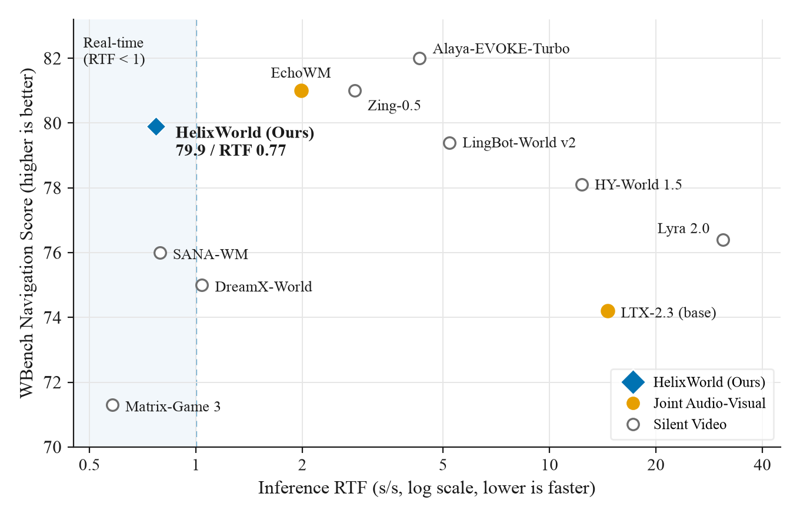
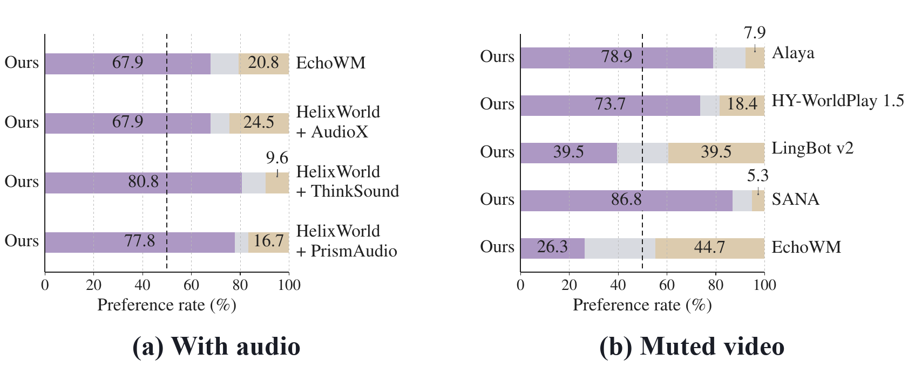
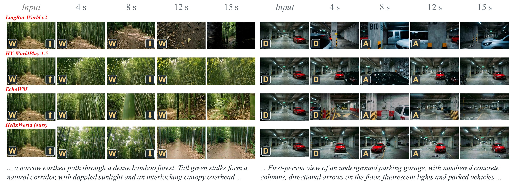
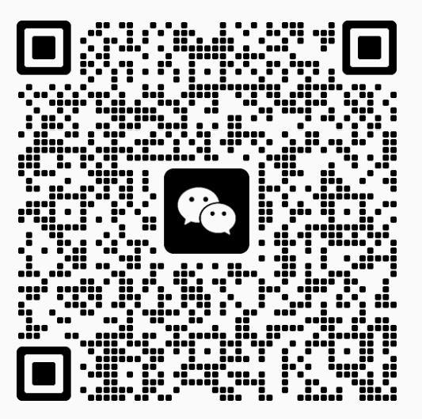

<p align="center">
  
</p>

# HelixWorld

<p align="center">
  <a href="README.md">English</a> | 简体中文
</p>

**HelixWorld** 是 [Noiz AI](https://noiz.ai) 推出的实时交互式音视频世界模型。

只需一张图片和一段提示词，就能进入一个可以自由探索的世界。无论向前走还是转身回望，画面与声音都会同步生成，空间声场也随镜头一起转动。声音不是事后配上的背景音轨，而是与画面一同诞生。

<p align="center">
  <a href="https://arxiv.org/abs/2609.38123"></a>
  <a href="https://huggingface.co/NoizAI/HelixWorld-preview"></a>
  <a href="https://huggingface.co/datasets/NoizAI/Helixbench"></a>
  <a href="https://helixworld.org/"></a>
  <a href="LICENSE"></a>
</p>

## 最新动态

- **2026-10-12**：发布交互式音视频世界模型评测基准 **HelixBench**，已上线 [Hugging Face](https://huggingface.co/datasets/NoizAI/Helixbench)。它用于评估生成的声场能否跟随视角的动态变化。
- **2026-09-29**：**HelixWorld** 技术报告已在 [arXiv](https://arxiv.org/abs/2609.38123) 发布。
- **2026-09-03**：开源 **HelixWorld Preview v1** 推理代码，预览版模型权重已上线 [Hugging Face](https://huggingface.co/NoizAI/HelixWorld-preview)。也可以直接访问 [helixworld.org](https://helixworld.org/)，在浏览器中漫游交互式世界。

## 实机演示

以下为 8 个场景的连续生成效果（左侧键位表示移动，右侧键位表示镜头视角）：

<table>
  <tr>
    <td align="center" width="50%"><br><b>草原骑行</b></td>
    <td align="center" width="50%"><br><b>水晶洞穴</b></td>
  </tr>
  <tr>
    <td align="center" width="50%"><br><b>素描画室</b></td>
    <td align="center" width="50%"><br><b>黄昏葡萄园</b></td>
  </tr>
  <tr>
    <td align="center" width="50%"><br><b>铅笔巴黎</b></td>
    <td align="center" width="50%"><br><b>乡间小路</b></td>
  </tr>
  <tr>
    <td align="center" width="50%"><br><b>阳光街道</b></td>
    <td align="center" width="50%"><br><b>喷泉广场</b></td>
  </tr>
</table>

## 核心特性

### 1. 音画同步

HelixWorld 是一个实时交互式音视频世界模型，在用户交互过程中，视觉场景与相机对齐的空间立体声原生地协同演化。在包含明显停顿的打鼓示例中，HelixWorld 生成的瞬态声音在停顿期间减弱，并随动作恢复；而后处理配音基线 AudioX 在停顿期间仍会产生瞬态声音。



### 2. 相机对齐的空间音频

连续的 6-DoF 相机位姿通过投影相对位置编码（PRoPE）注入视频分支，再由跨模态注意力将视觉几何与声学特征绑定，从而把相机自身运动自然地转化为真实的立体声声像偏移。[HelixBench](https://huggingface.co/datasets/NoizAI/Helixbench) 用于评估生成的声场能否跟随视角的动态变化。在该基准上，HelixWorld 的空间声学一致性优于 EchoWM 及级联的视频到音频（V2A）配音方案。



### 3. 单卡实时推理

在单张 NVIDIA H800 上，HelixWorld 以 768×512 分辨率、24 FPS 运行，稳态实时因子（RTF）为 0.77（含视频与音频解码）。在 WBench 导航评测中，其视觉质量与控制响应优于大多数开源无声基线。



### 4. 用户研究

在开启音频的成对盲测中，HelixWorld 以明显优势胜过所有基线，在每组对比中均获得多数投票。



在相同首帧与控制输入下，HelixWorld 在前进漫游与运动反向过程中均能保持场景结构：



## 快速开始

### Preview v1

环境要求：

- Linux、Python 3.11、CUDA 12.x
- NVIDIA GPU，建议 80 GB 显存
- 已安装 `ffmpeg` 与 `ffprobe`

实测 BF16 精度下单卡推理约占用 70 GB 显存。

```bash
git clone https://github.com/NoizAI/HelixWorld.git
cd HelixWorld

conda create -n helixworld-preview python=3.11 -y
conda activate helixworld-preview
python -m pip install -r requirements.txt
python download_models.py
```

下载完成后，模型目录结构如下：

```text
models/
├── text_encoder/gemma-3-12b/
└── weights/
    └── model.safetensors
```

运行推理：

```bash
CUDA_VISIBLE_DEVICES=0 ./run.sh \
  --image /path/to/first_frame.png \
  --prompt-file examples/prompt.json \
  --actions "W:5,right:5,stop:5" \
  --perspective first_person \
  --num-frames 121 \
  --output-dir outputs/demo
```

提示词可在 [`examples/prompt.json`](examples/prompt.json) 中修改，也可以通过 `--video-prompt`、`--audio-prompt` 和 `--av-prompt` 直接传入。生成的成片 MP4 保存在 `<output-dir>/release/native/` 目录下。

**动作说明**：支持 `W` `A` `S` `D` `left` `right` `up` `down` `stop`，多个动作可用 `+` 组合（如 `W+D:8`）。冒号后的数字表示该动作持续的潜变量转移（latent transition）次数，121 帧共对应 15 次。最后一段动作可以不写时长。

## 引用

如果 HelixWorld 对你的研究有帮助，欢迎引用：

```bibtex
@article{ke2026helixworld,
  title={HelixWorld: A Real-time Interactive Audio-Visual World Model},
  author={Ke, Lei and Pan, Jiahao and Tian, Zeyue and Wang, Jiaming and Huang, Haoyuan and Wu, Kam Man and Fang, Pengjun and Liu, Hongyu and Qi, Chenyang and Wang, Lin and others},
  journal={arXiv preprint arXiv:2609.38123},
  year={2026}
}
```

## 许可证

代码基于 [Apache 2.0](LICENSE) 协议开源。模型权重的许可协议随 [Preview v1 权重](https://huggingface.co/NoizAI/HelixWorld-preview)一同发布。

## 用户交流群

欢迎扫码加入用户群，交流使用心得、反馈问题，第一时间获取项目动态。

<table align="center">
  <tr>
    <td align="center"><br><b>微信群</b></td>
    <td align="center"><br><b>Discord</b></td>
  </tr>
</table>
